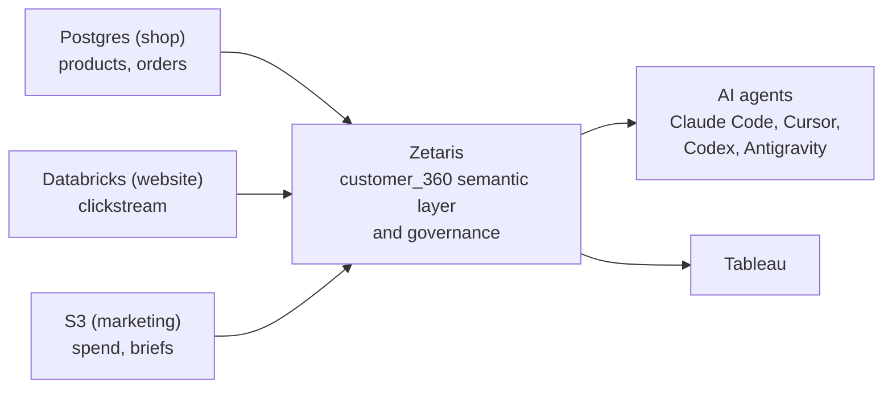

# Make Your Data AI-Ready with Zetaris

This is the companion repo for my course on building a data harness for AI with Zetaris. By the end, Claude Code, Cursor, Codex and Antigravity answer real business questions across Postgres, S3 and Databricks, without moving or copying a single row of data.

The dataset, every setting, every SQL statement and every command from the videos are in here, so you can follow along at your own pace or look something up when you get stuck.

## What you'll build

Northbound Outfitters is an invented outdoor gear retailer, and its data is spread out the way it usually is in a real company: orders in Postgres, the website clickstream in Databricks and the marketing spend in S3. No single system can answer the questions that matter, so you connect all three in Zetaris and build one semantic layer on top.



When you're done you'll have:

- A Zetaris cluster running in your own AWS account, on the free Hobby tier
- One SQL query that joins Postgres, S3 and Databricks at the same time
- A semantic layer, `customer_360`, with business names, keys and descriptions
- An `ai_analyst` role that can read the semantic layer, but can't touch the raw sources or `product.unit_cost`
- The same semantic layer served to Tableau and to four different AI agents

## Why a data harness

Think about Claude Code or Cursor. The model on its own just predicts text, and the harness around it gives it files, a terminal and tools. Zetaris is the same idea for data: it connects your sources, gives the data meaning through the semantic layer, controls who sees what, and hands all of that to whatever tool needs it.

The cool thing is that your data stays where it is, so there's no pipeline to build and no copy that goes out of date. And no, federation isn't always faster. If you query the same big table a thousand times a day, storing a copy can make sense. The difference is that copying becomes your choice instead of the default.

Everybody talks about which AI agent is the best one, but honestly the agent is the easy part. All four connect the same way in chapter 4, and that only works because the data underneath is ready for them.

## Prerequisites

**Accounts**

- A [Zetaris](https://zetaris.com) account on the Hobby tier (free)
- A verified AWS account. This is the one that costs real money, see [the costs section](#what-this-costs-you) before you start
- A [Databricks Free Edition](https://www.databricks.com/learn/free-edition) account

**On your machine**

- `git`
- The `psql` client, to load the data into Aurora
- `python3`, for the setup check in chapter 4
- Tableau Desktop for lesson 3.6 (the free trial works). You can skip this lesson if you only care about the AI agents
- At least one AI agent for chapter 4. Claude Code, Cursor, Codex or Antigravity, you don't need all four. Codex also needs Node.js

> **Heads up:** New AWS accounts have a low quota for on-demand instances, and the cluster needs 12 vCPUs. Request at least 16 before you start, because the approval isn't always instant. [Lesson 2.1](lesson-resources/2-1_sign-up-and-deploy-cluster.md) shows you where.

## Get started

1. Clone this repo. You need it locally because you upload the dataset from it.

   ```bash
   git clone https://github.com/andkret/zetaris-data-harness-for-ai.git
   cd zetaris-data-harness-for-ai
   ```

2. Deploy your cluster with [lesson 2.1](lesson-resources/2-1_sign-up-and-deploy-cluster.md). It takes about 20 minutes until everything is up in AWS.

3. Set a schedule for your cluster right away with [lesson 2.2](lesson-resources/2-2_tour-the-platform.md), so it doesn't run while you sleep.

4. Work through the lessons below in order. Each one builds on the one before, and the names need to match, so use the [names from the course](#names-used-throughout-the-course) and you can copy and paste everything.

## The course, lesson by lesson

Every link in the first column goes to the copy and paste page for that lesson: settings, SQL, commands and the results you should see. The videos explain the why, and these pages are there so you don't have to pause and type.

The theory lessons (1.0 to 1.2, 3.1, 4.1 and the wrap-up in 5.1) don't have a page because there's nothing to set up.

### Chapter 2: Set up Zetaris and connect your data

| Lesson | What you do | Written guide |
|---|---|---|
| [2.1 Sign Up and Deploy Your Cluster](lesson-resources/2-1_sign-up-and-deploy-cluster.md) | Deploy Zetaris into your AWS account with the CloudFormation quickstart | |
| [2.2 Tour the Platform and Set Auto-Suspend](lesson-resources/2-2_tour-the-platform.md) | Set a schedule and sign in to the cluster | |
| [2.3 Set Up Sample Data](lesson-resources/2-3_set-up-sample-data.md) | Upload the marketing data to S3 and load Aurora | [S3 bucket](written-guides/2-3_create-an-S3-bucket.md), [Aurora](written-guides/2-3_create-aurora-postgres-db.md) |
| [2.4 Connect Postgres and S3](lesson-resources/2-4_connect-postgres-and-s3.md) | Register the `shop` and `marketing` sources | |
| [2.5 Set Up and Connect Databricks](lesson-resources/2-5_set-up-and-connect-databricks.md) | Load the clickstream and register the `website` source | [Databricks Free Edition](written-guides/2-5_set-up-databricks-free-edition.md) |

### Chapter 3: Build and govern the semantic layer

| Lesson | What you do | Written guide |
|---|---|---|
| [3.2 Set Up a Semantic Layer](lesson-resources/3-2_set-up-semantic-layer.md) | Create `customer_360` from [`usl/customer_360.sql`](usl/customer_360.sql) and activate its tables | |
| [3.3 Query Director: Querying Our Data](lesson-resources/3-3_query-director.md) | Run queries across all three sources | |
| [3.4 Configure the Semantic Layer](lesson-resources/3-4_configure-semantic-layer.md) | Add the meaning the AI needs to understand your data | |
| [3.5 Govern What the AI Is Allowed to See](lesson-resources/3-5_governance.md) | Create the `ai_analyst` role, the agent user and the column policy | |
| [3.6 Bring the Semantic Layer to Your BI Tool](lesson-resources/3-6_connect-tableau.md) | Publish a metric as a view and open it in Tableau | [Tableau connection](written-guides/3-6_create-zetaris-tableau-connection.md) |

### Chapter 4: Connect your AI agents

Pick the agent you actually use. Every lesson works on its own and repeats the full setup, so you don't have to do all four. Super important: finish lesson 3.5 first, because the agent logs in as the governed agent user and not as your admin.

| Lesson | What you do |
|---|---|
| [4.2 Connect Claude Code](lesson-resources/4-2_connect-claude-code.md) | Create the agent's token, configure `.env.local`, ask your first questions |
| [4.3 Connect Cursor](lesson-resources/4-3_connect-cursor.md) | The same setup in Cursor |
| [4.4 Connect Codex](lesson-resources/4-4_connect-codex.md) | The same setup in Codex |
| [4.5 Bonus: Connect Google Antigravity](lesson-resources/4-5_connect-antigravity.md) | The same setup in Antigravity |

All four use Zetaris' own [getting-started repository](https://github.com/zetaris/getting-started), which you clone in the lesson. Your answers will be worded differently from mine because agents answer differently from run to run, but the numbers stay the same because they all read the same semantic layer.

## What's in this repo

```text
.
├── lesson-resources/   The copy and paste page for every lesson. Start here
├── written-guides/     Step-by-step setup for AWS S3, Aurora, Databricks, Tableau and the teardown
├── output/             The Northbound Outfitters dataset
│   ├── postgres/       schema.sql, products.csv, orders.csv
│   ├── databricks/     Clickstream as Parquet, one folder per month
│   └── s3/marketing/   Daily spend and the campaign briefs
├── usl/                customer_360.sql, the semantic layer model
├── docs/               My video scripts
└── images/             Screenshots used in the written guides
```

The `docs/` folder is what I read on camera, so it's full of notes like "wait for the click" and "cut here". It's handy if you want the full explanation in text, but if you just want to get the thing working, stay in `lesson-resources/`.

## The dataset

Everything in [`output/`](output/) is synthetic: the company, the products, the customers and the campaigns are all invented. It covers January to June 2026, in USD and UTC, and it's about 18 MB in total.

| Where it goes | What it is | Size |
|---|---|---|
| Postgres | 300 products and 11,192 order lines | about 1.1 MB |
| Databricks | 2,000,000 clickstream events | 17 MB |
| S3 | 1,192 rows of daily marketing spend and 10 campaign briefs | about 95 KB |

The files are fixed, so you get exactly the same data I have in the videos. For the join keys and the full data dictionary, check [`output/README.md`](output/README.md).

## Names used throughout the course

The SQL in the lessons uses these names. If you change one, you have to change it everywhere, so I'd just keep them.

| Thing | Name |
|---|---|
| Postgres source in Zetaris | `shop` |
| S3 source in Zetaris | `marketing` (tables `spend`, `briefs`) |
| Databricks source in Zetaris | `website` (table `clickstream`) |
| Semantic layer | `lightning.metastore.northbound.customer_360` |
| AI agent role | `ai_analyst` |
| AWS region in the videos | `us-east-1` |

## What this costs you

The Zetaris software is free on the Hobby tier, but it runs in your own AWS account and AWS bills you for it. Suspending the cluster stops the machines, which is the biggest part of the bill, but the control plane, the NAT gateway, the load balancers, the database and the storage keep costing money until you delete them.

So set the schedule in [lesson 2.2](lesson-resources/2-2_tour-the-platform.md), and when you're finished, do NOT just suspend the cluster and walk away. Follow the [teardown guide](written-guides/tear-down-everything.md) from top to bottom, because the order matters: some resources can only be deleted once others are gone.

Databricks Free Edition doesn't cost anything, and Tableau's trial is free as well.

## Troubleshooting

These are the problems that come up most. Each lesson page has more, under "Known pitfalls".

**"Not enough vCPU" when creating the cluster**
Your AWS quota is too low. Request at least 16 for **Running On-Demand Standard** instances under **Service Quotas**, as shown in [lesson 2.1](lesson-resources/2-1_sign-up-and-deploy-cluster.md).

**"Verify" fails right after the CloudFormation stack is created**
The stack isn't finished yet. Wait until it shows `CREATE_COMPLETE` and click **Verify** again.

**The Postgres connection times out**
Aurora pauses after five minutes without activity and takes about 15 seconds to wake up, which is longer than Zetaris waits. Run any query against it first, wait a few seconds and try again.

**Extra `month` column or errors when reading the spend files**
You probably skipped `recursiveFileLookup` when registering the S3 source. See [lesson 2.4](lesson-resources/2-4_connect-postgres-and-s3.md).

**`No suitable driver` or `No tables found` with Databricks**
The JDBC URL needs `jdbc:databricks://` with both slashes, and `/northbound` right after `:443`. The full table of errors is in [lesson 2.5](lesson-resources/2-5_set-up-and-connect-databricks.md).

**`Integer is not a valid external type for schema of bigint` during activation**
Drag-and-drop activation doesn't cast types, so only `product` uses it. Use **Activate from SQL** with the queries from [lesson 3.2](lesson-resources/3-2_set-up-semantic-layer.md) for the other tables.

**The agent can suddenly see `unit_cost`**
Assigning a policy to a role can reset the user's *Role Policy* field, and then the policy no longer applies. Check the field again and test as the agent user after every change, as described in [lesson 3.5](lesson-resources/3-5_governance.md).

**The agent can't connect, or the setup check fails**
Open `.env.local` and make sure every variable appears only once. A second, empty or `localhost` line further down overrides your value, and it's very, very easy to miss.

**Tableau shows no tables**
The data mart was probably never saved. The **Save** button only appears after you've added a table. See [lesson 3.6](lesson-resources/3-6_connect-tableau.md).

## Next steps and where to get help

Before you tear everything down, keep asking your agent questions. There's a lot more in this dataset than we look at in the videos, and I give you a few ideas in lesson 5.1.

After that, try it on your own data. The Hobby tier is free, so you can connect your own sources and see how far you get. For everything beyond this course, Zetaris has its [getting-started repository](https://github.com/zetaris/getting-started) and its [knowledge base](https://kbase.zetaris.com) with the full SQL reference.

If you get stuck on something in here, open an issue on this repo. And if you want to go deeper into data engineering, you'll find all my courses at the [Learn Data Engineering Academy](https://learndataengineering.com).

Have fun building this, and don't forget to [tear it down](written-guides/tear-down-everything.md) when you're done!

Andreas
