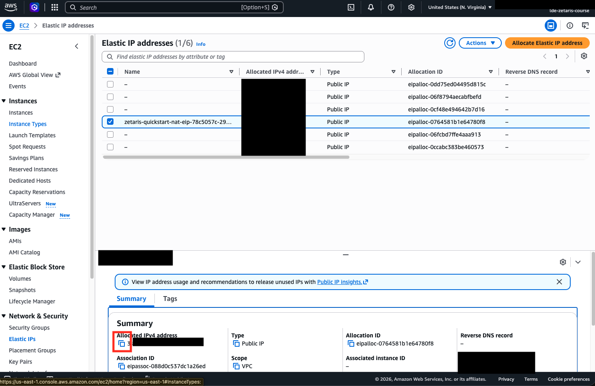
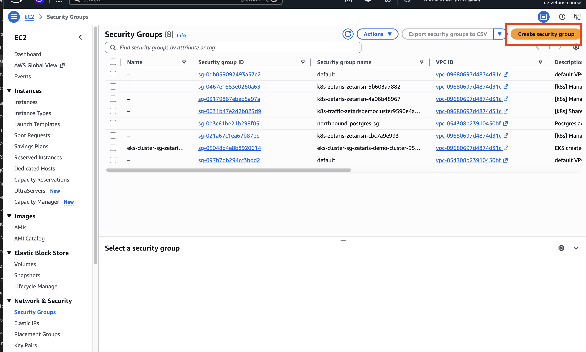
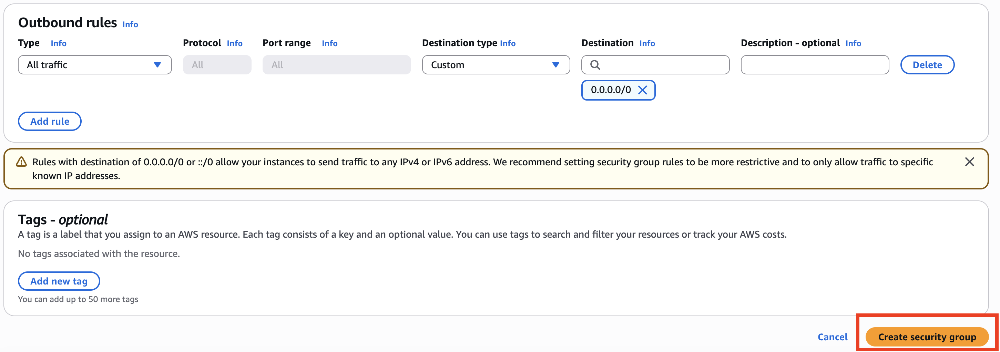
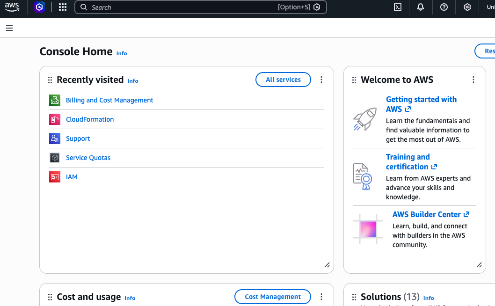
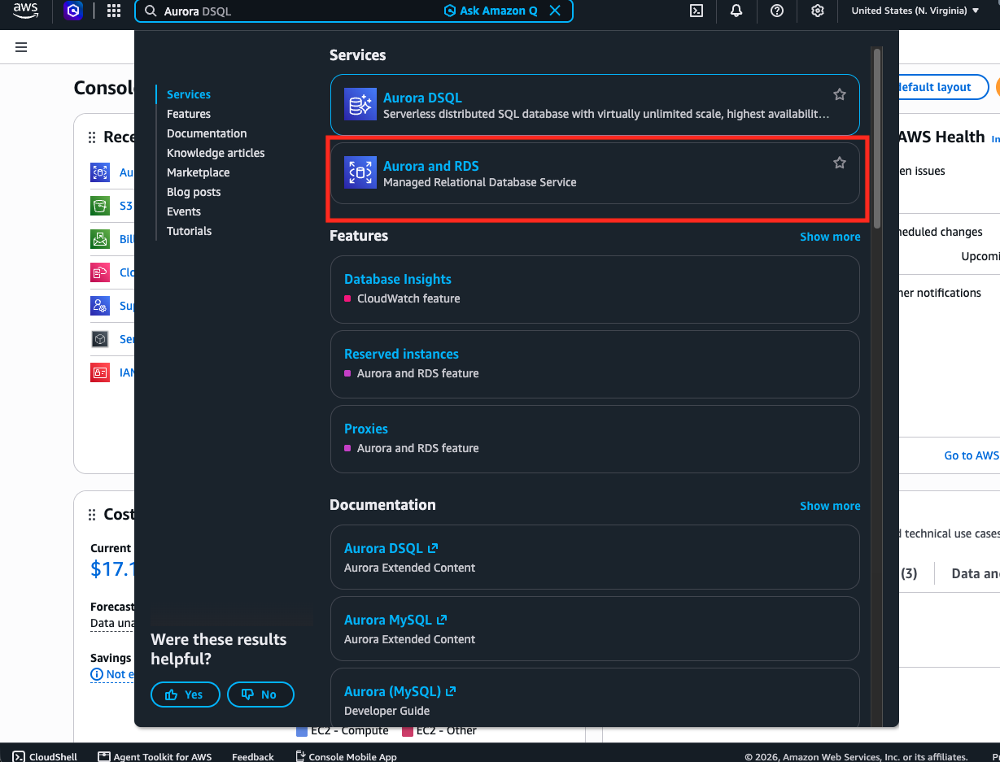
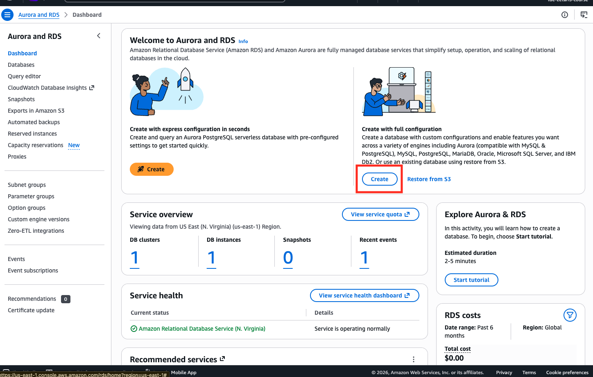
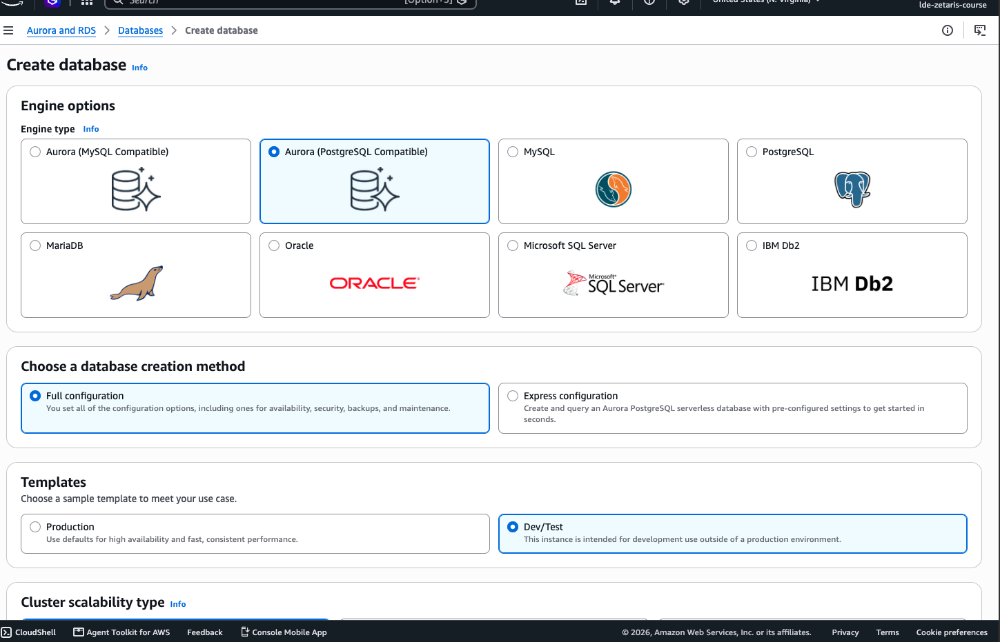
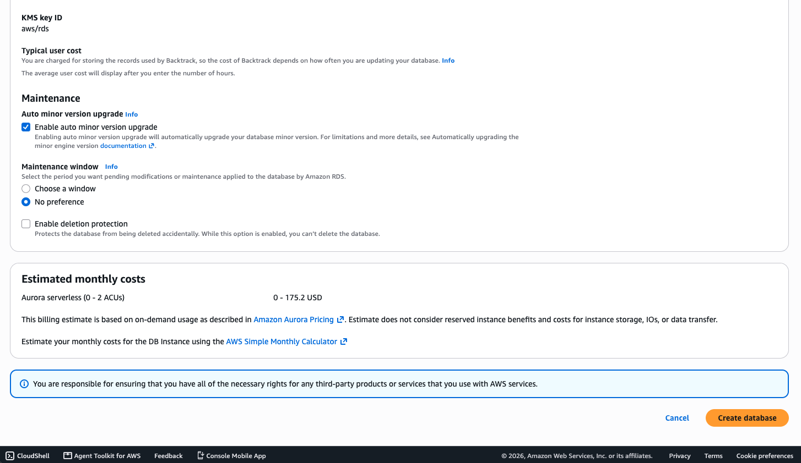
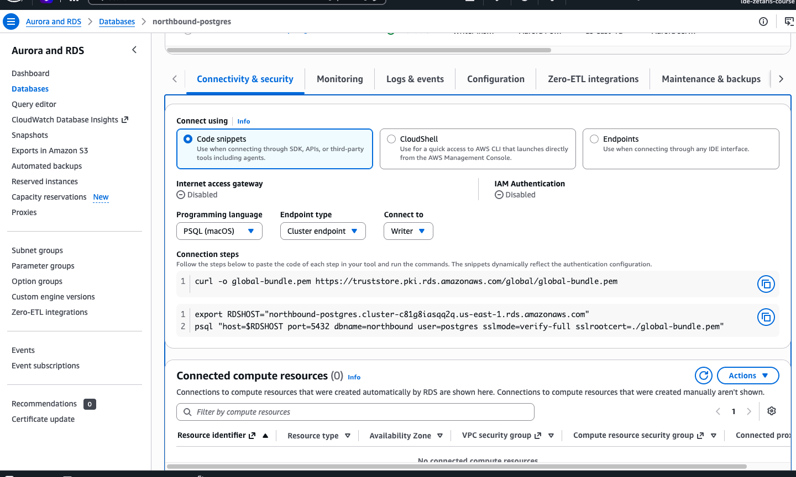

# 2.3 Create an Aurora PostgreSQL Database

The second place for our data is a Postgres database. In a real company, this would be the operational database behind the online shop, holding products and orders. We use Amazon Aurora PostgreSQL in its serverless version: it scales down to zero when nobody is using it, so it costs almost nothing while you're not working on the course.

> [!IMPORTANT]
> Make sure the region in the top right is **US East (N. Virginia) us-east-1**, the same as your Zetaris cluster.

## Create a security group

Before we create the database, we decide who's allowed to connect to it. A security group is AWS's firewall: we allow exactly two addresses, your own computer, so you can load the data, and your Zetaris cluster.

First, find the IP address of your Zetaris cluster. In the search bar, type in 'EC2' and open **EC2 → Elastic IPs**. Copy the IP address of `zetaris-quickstart-nat-eip-…`. This is the address your Zetaris cluster uses to reach the internet.



Then go to **EC2 → Security Groups** and click on **Create security group**.


Use these settings:
- **Security group name:** northbound-postgres-sg
- **Description:** Postgres access for my computer and Zetaris
- **VPC:** The default VPC (not the Zetaris VPC)
- **Inbound rules:** Add two rules:
  - **Type:** PostgreSQL, **Source:** My IP
  - **Type:** PostgreSQL, **Source:** Custom, then paste the Zetaris IP followed by `/32` (e.g. `3.211.45.67/32`)
- **Outbound rules:** Keep the default
- **Tags:** None

Then click **Create security group**.



> **If you can't connect later:** home internet connections often get a new IP address from time to time. If your connection to the database suddenly hangs, edit the inbound rules of `northbound-postgres-sg` and select **My IP** again.

## Create the database

Go to the AWS home page. It should look like this:



In the search bar, type in 'Aurora' and select the **Aurora and RDS**. 



Then use the option **Create** for the full configuration.

> **Don't use the express configuration.** It looks convenient, but it only allows IAM authentication and can't be changed later. Zetaris needs a regular username and password. Choose **Full configuration** instead.



This will lead you to the full configuration page.



Use these settings:

**Engine**
- **Creation method:** Full configuration
- **Engine type:** Aurora (PostgreSQL Compatible)
- **Cluster scalability type:** Aurora serverless
  - **Minimum capacity (ACUs):** 0
  - **Maximum capacity (ACUs):** 2
  - **Pause after inactivity:** 00:05:00
- **Engine version:** Aurora PostgreSQL (Compatible with PostgreSQL 17.x)
- **Enable RDS Extended Support:** Unchecked
- **Templates:** Dev/Test

**Settings**
- **DB cluster identifier:** northbound-postgres
- **Master username:** postgres
- **Credentials management:** Self managed, then set your own password. Save it, you'll need it for loading the data and for connecting Zetaris. Stick to letters, digits, `-` and `_`; special characters like `@` or `/` can break connection strings.
- **IAM database authentication / Kerberos authentication:** Unchecked

**Storage and availability**
- **Cluster storage configuration:** Aurora Standard
- **Multi-AZ deployment:** Don't create an Aurora Replica

**Connectivity**
- **Compute resource:** Don't connect to an EC2 compute resource
- **Network type:** IPv4
- **Virtual private cloud (VPC):** Default VPC
- **DB subnet group:** default
- **Public access:** Yes
- **VPC security group:** Choose existing, select `northbound-postgres-sg` and remove `default`
- **Availability Zone:** No preference
- **RDS Proxy:** Unchecked
- **Certificate authority:** Default
- **RDS Data API:** Unchecked
- **Database port:** 5432

**Optional sections** (leave empty or unchecked): Capacity reservations, Read replica write forwarding, Tags, IAM roles, Babelfish.

**Monitoring**
- **Database Insights:** Standard
- **Enable collecting detailed per-query and database counter metrics:** Unchecked
- **Enhanced Monitoring:** Unchecked

**Additional configuration**
- **Initial database name:** northbound (without it, RDS doesn't create a database)
- **DB cluster parameter group / DB parameter group:** Default
- **Failover priority:** No preference
- **Backup retention period:** 1 day
- **Backup window:** No preference
- **Encryption key:** AWS managed KMS key (default)
- **Log exports:** All unchecked
- **Auto minor version upgrade:** Checked
- **Maintenance window:** No preference
- **Enable deletion protection:** Unchecked

Then click **Create database**. Creating the database may take about 10 minutes.



## Connect to the database

Once the database shows **Available**, open `northbound-postgres` and go to the **Connectivity & security** tab. Under **Connect using**, keep **Code snippets** and select:
- **Programming language:** PSQL (for your operating system)
- **Endpoint type:** Cluster endpoint
- **Connect to:** Writer



Run the commands from the **Connection steps** in your terminal, from the root of the repository. The first one downloads the AWS certificate bundle, so `psql` can verify it's really talking to your database:

```bash
curl -o global-bundle.pem https://truststore.pki.rds.amazonaws.com/global/global-bundle.pem
```

The second one sets your database's address and connects. Your endpoint will be different:

```bash
export RDSHOST="<your-cluster-endpoint>"
psql "host=$RDSHOST port=5432 dbname=northbound user=postgres sslmode=verify-full sslrootcert=./global-bundle.pem"
```

Enter your password when asked. If the connection takes around 15 seconds, the database is waking up from pause. That's expected.

You'll also need the cluster endpoint later, when connecting Zetaris, so keep it handy.