# 2.5 Set Up Databricks Free Edition

Our third data source is Databricks. In a real company, this is the analytics platform where raw behavioural events from the website land: page views, product views, carts and checkouts. Databricks offers a Free Edition that is all we need for this course. This guide walks you through creating it.

## Create your Free Edition account

Go to the [Databricks Free Edition](https://www.databricks.com/learn/free-edition) page and click 'Sign up'.

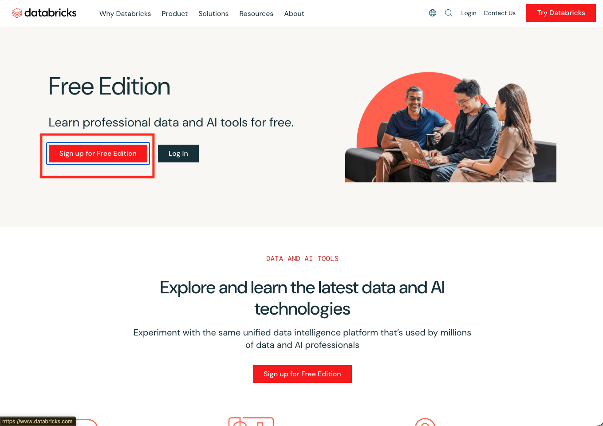

Sign up with your email address or an existing Google or Microsoft account.

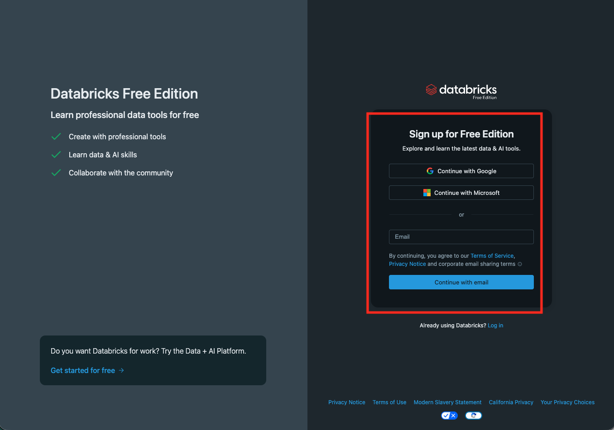

If you signed up with your email address, Databricks sends you a verification code. Enter it to continue.

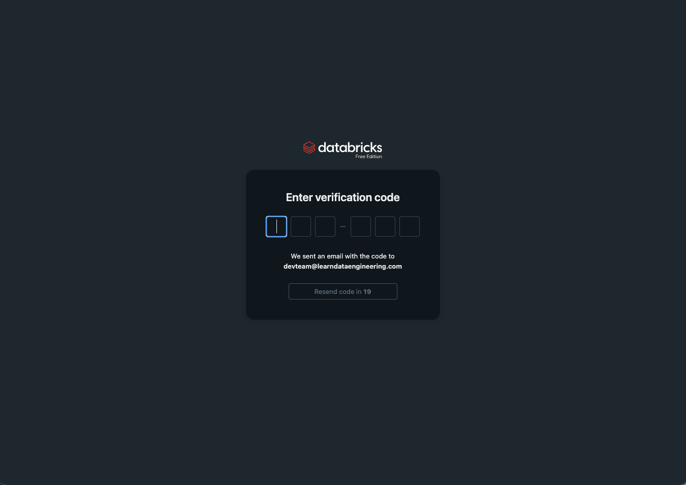

Name your account and set your location.

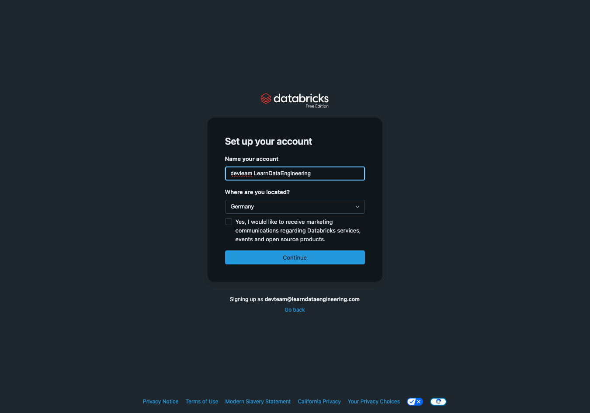

Databricks now creates your workspace. This takes a minute or two.

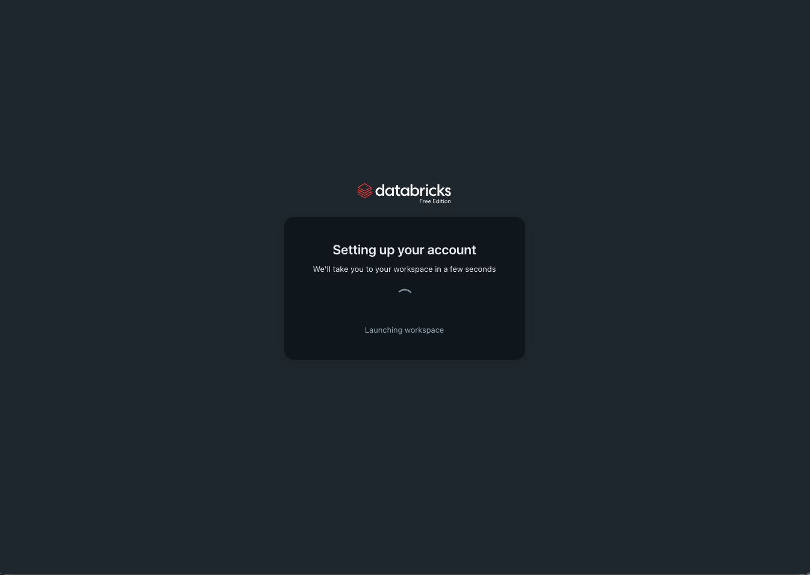

Once it's done, you land on the home page of your workspace.

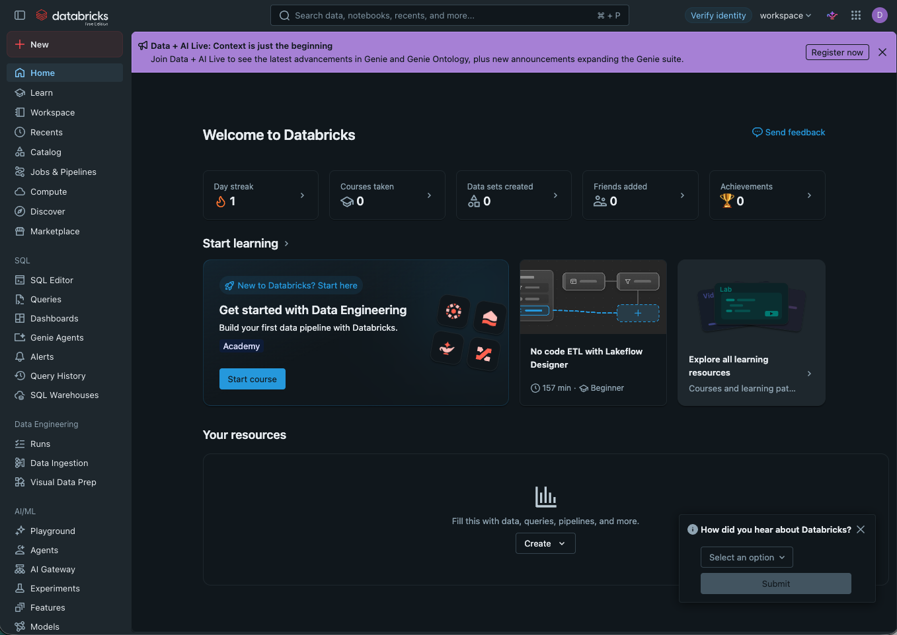

> **Free Edition limits:** Free Edition is free, but it comes with daily compute limits and only serverless compute. Our dataset of two million events stays well within them.

## Check your SQL warehouse

Zetaris connects to Databricks through a SQL warehouse. Free Edition comes with one already set up.

On the left, click on **SQL Warehouses**. You should see the **Serverless Starter Warehouse**.

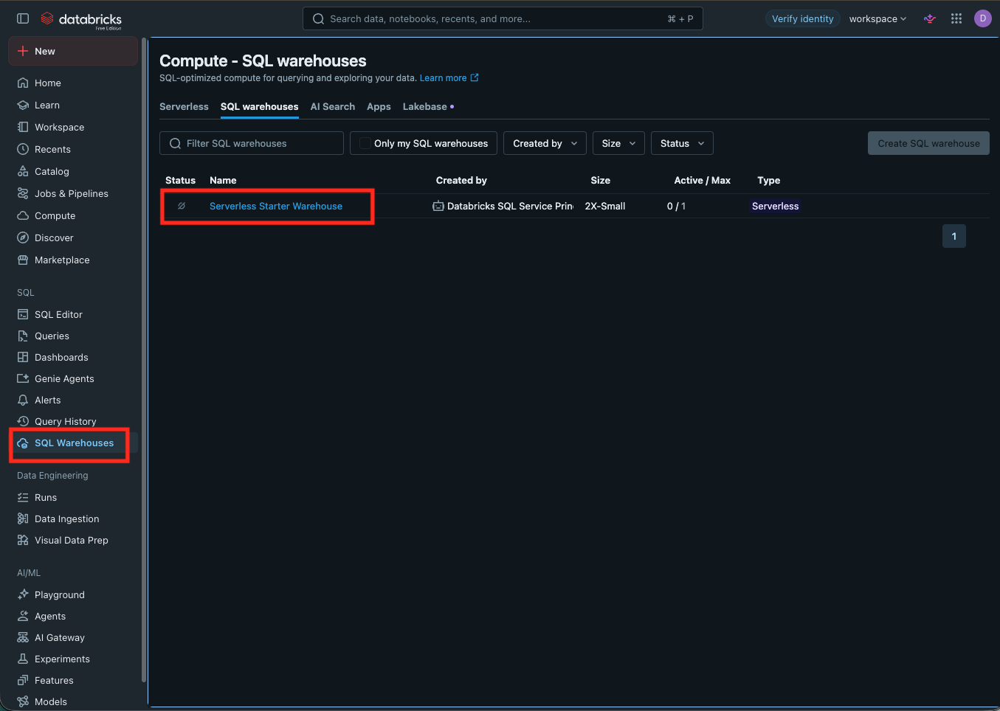

Open it and switch to the **Connection details** tab. Note down the **Server hostname** and the **HTTP path**. You'll need both when connecting Zetaris.

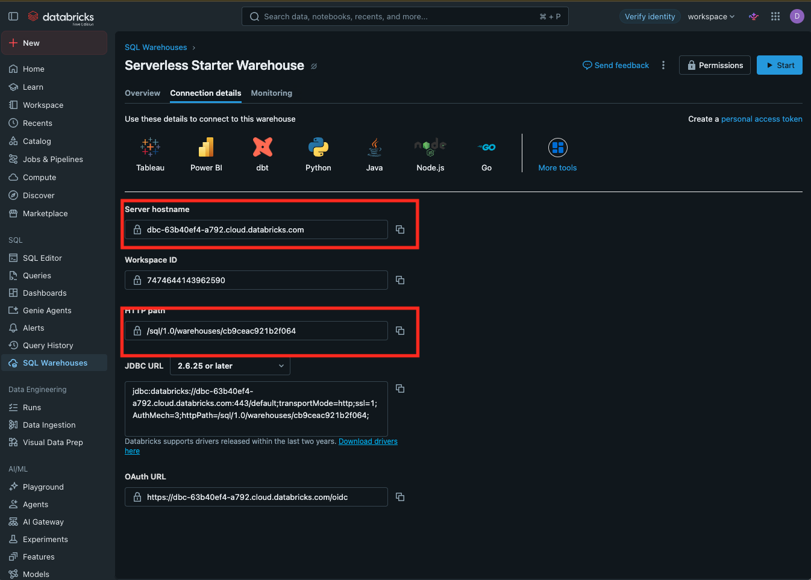

> **The warehouse stops when idle.** To save compute, the warehouse shuts down after a few minutes without queries and needs a moment to start again. If a connection from Zetaris times out, start the warehouse here and try again.

## Create a service principal for Zetaris

Zetaris gets its own identity in Databricks: a service principal that can read exactly one schema and use one SQL warehouse, nothing else.

### Create the service principal

Click on your profile in the top right and open **Settings**. Under **Identity and access**, go to **Service principals** and click 'Manage', then 'Add service principal' and 'Add new'.

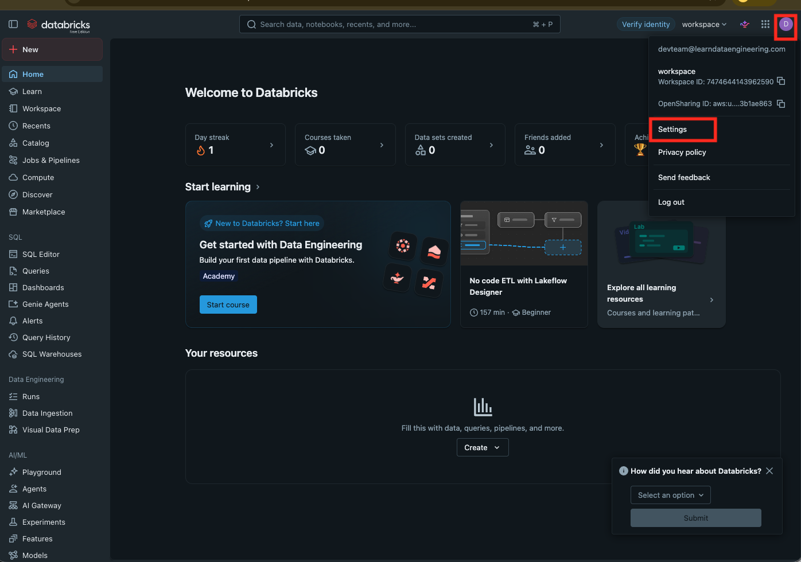

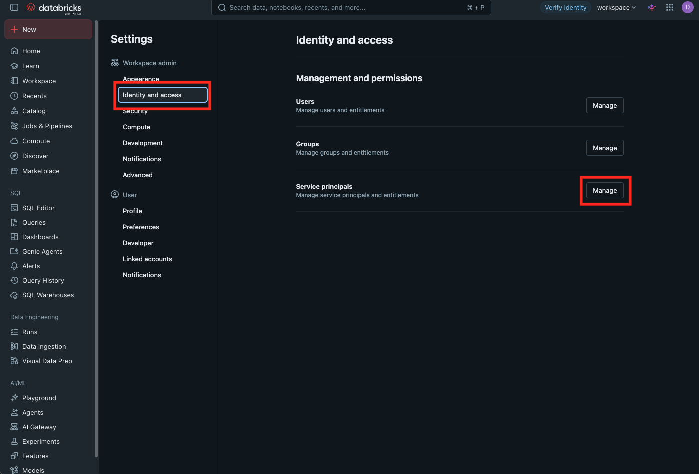

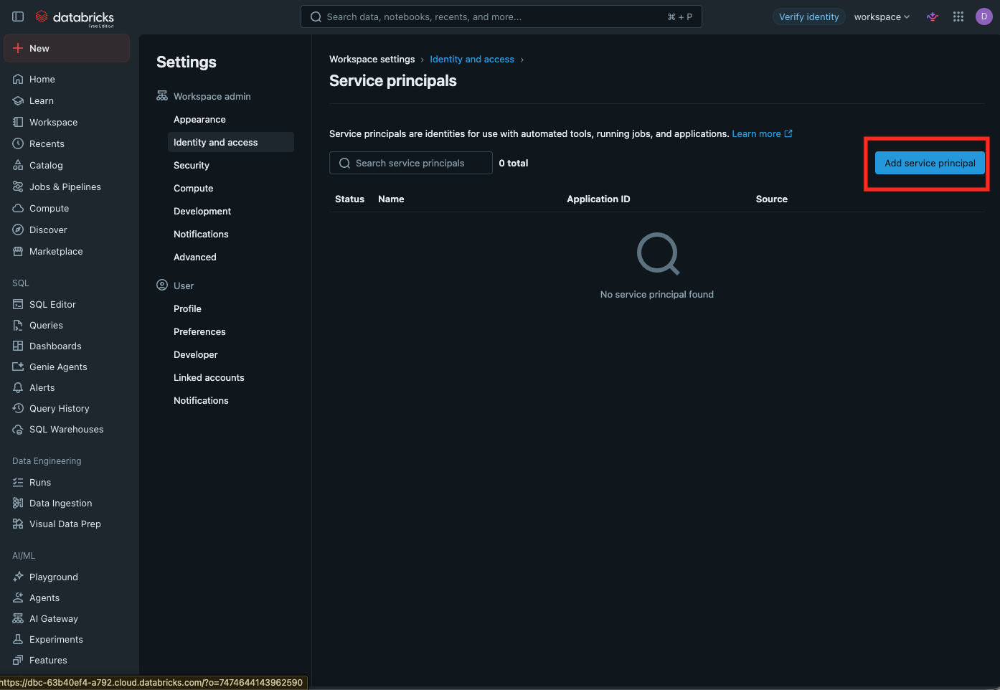

Select that you want to create a new service principal.

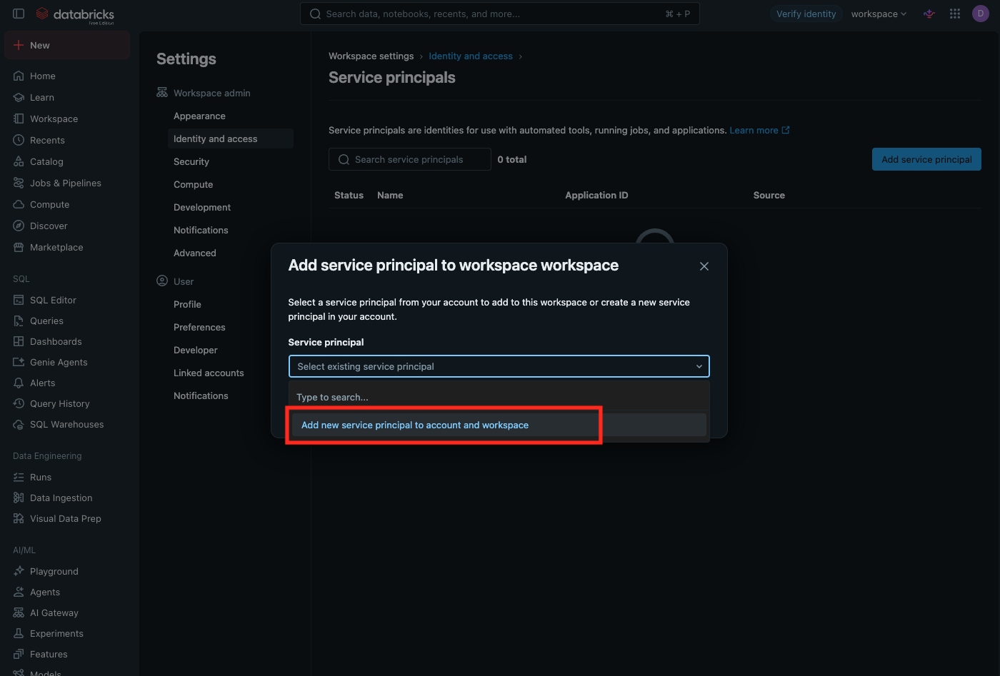

Name it `zetaris-reader` and click 'Add'.

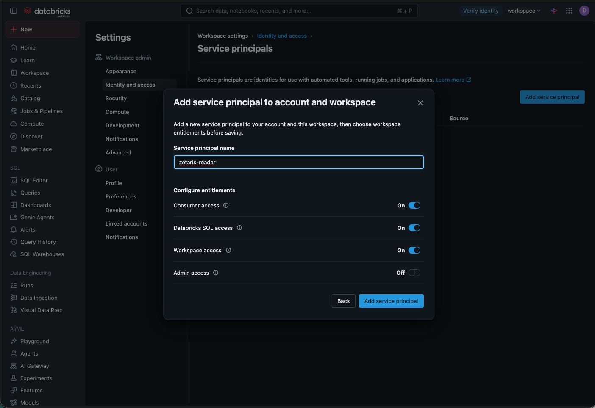

### Generate an OAuth secret

Open `zetaris-reader`, switch to the **Secrets** tab and click 'Generate secret'.

- **Lifetime (days):** 30
- **Scope:** BI Tools (this limits the secret to `sql`, which is all Zetaris needs)

Click 'Generate'. Copy the **Client ID** and the **Secret** right away. You can only see the secret once.

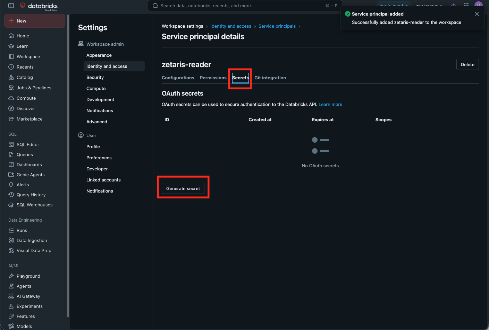

### Grant read access to the data

Open the **SQL Editor** and run the following, with your service principal's Client ID between the backticks:

```sql
GRANT USE CATALOG ON CATALOG workspace TO `<client-id>`;
GRANT USE SCHEMA, SELECT ON SCHEMA workspace.northbound TO `<client-id>`;
```

This lets the service principal read the tables in the `northbound` schema, and nothing else in your workspace.

### Allow it to use the SQL warehouse

On the left, go to **SQL Warehouses**, open the **Serverless Starter Warehouse** and click 'Permissions'. Add `zetaris-reader` with **Can use** and click 'Save'.

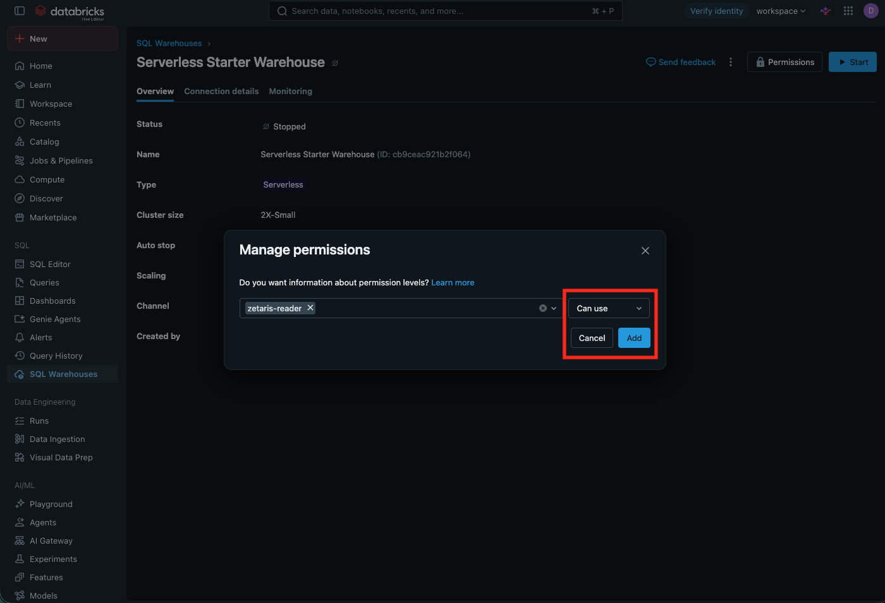

> **"No existing owner" error?** The starter warehouse was created automatically and has no owner. Click the cog icon in the permissions dialog, choose 'Assign new owner', select yourself, and save again.

Keep the **Server hostname** and **HTTP path** from the warehouse's **Connection details** at hand. You'll need them together with the Client ID and the Secret when connecting Zetaris.

> **Delete the secret when you're done with the course.** It expires after 30 days anyway, but there's no reason to keep it around.